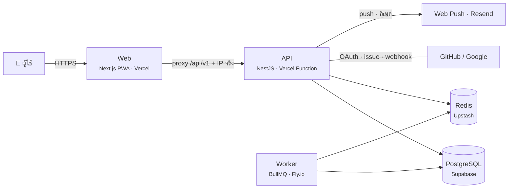

# NOSION — Personal Productivity OS

ระบบจัดการชีวิตที่ต่อโมดูลเพิ่มได้ — งาน การเงิน ออกกำลังกาย และนิสัย
อยู่บนโครงสร้างข้อมูลเดียวกัน จึงดูรวมกันได้ในหน้าเดียวโดยไม่ต้องสลับแอป

> **สถานะปัจจุบัน:** Phase 0–8 เสร็จแล้ว (Phase 6 ทำเฉพาะ Habit — ตัด Workout · Phase 8 ข้าม Import CSV/Todoist)
> — ดู [แผนงานเต็ม](#ทำอะไรต่อ) ท้ายเอกสาร · บันทึกรายขั้นที่ [docs/phases](docs/phases/README.md)

**ลองใช้:** เปิดเว็บแล้วกด **"ลองใช้ทันที"** — ได้บัญชีทดลองพร้อมข้อมูลตัวอย่างใน 1 คลิก ไม่ต้องสมัคร
(สลับ ไทย / English ได้ที่หน้าแรก) · บัญชีจริงเข้าด้วยอีเมล หรือ **Google / GitHub** ก็ได้

---

## นี่คืออะไร

To-do list เป็นโปรเจกต์ที่ถูกทำซ้ำมากที่สุดใน GitHub โปรเจกต์นี้จึงไม่ได้ตั้งใจทำ CRUD ให้สวย
แต่ตั้งใจเลือกโจทย์ที่**มีความยากทางเทคนิคที่จับต้องได้** แล้วแก้ให้ถูกต้องจริง

สิ่งที่ใช้งานได้แล้วตอนนี้:

- สมัคร / เข้าสู่ระบบ / ออกจากระบบ พร้อม refresh token rotation และ reuse detection
- บัญชีทดลอง — กดปุ่มเดียวจากหน้าแรก เข้าใช้ได้ทันทีพร้อมข้อมูลตัวอย่าง
- จัดการงาน: สร้าง ค้นหา กรอง เรียง ทำเสร็จ เลื่อน ลบ กู้คืน พร้อม optimistic update
- โปรเจกต์และแท็ก, การตั้งค่าผู้ใช้ (โซนเวลา ภาษา สกุลเงิน โมดูลที่เปิด)
- การเงิน: บันทึกด่วน "กาแฟ 65", งบประมาณ, บิลประจำ, คาดการณ์สิ้นเดือน, กราฟย้อนหลัง
- การเกิดซ้ำ (RRULE + timezone + DST + วันสิ้นเดือน) และการเตือนผ่าน Web Push / อีเมล
- ปฏิทินรวมทุกโมดูล + iCal feed · Command Palette ⌘K สร้างรายการจากประโยคภาษาไทย/อังกฤษ · ปุ่มลัดครบ
- นิสัย: นับจำนวน / ติ๊ก / ก่อนเวลา / รายสัปดาห์ พร้อม streak · สรุปรายสัปดาห์รวมทุกโมดูล
- ใช้ตอนไม่มีเน็ตได้ (outbox + sync + แก้ชนระดับ field) · ติดตั้งเป็นแอปบนมือถือได้ (PWA)
- **ภาษาไทย / อังกฤษ** ทั้งแอป อีเมล และการแจ้งเตือน · เลือกแสดงปี พ.ศ./ค.ศ. ได้
- เข้าสู่ระบบด้วย **Google / GitHub** (OAuth + PKCE) · ผูกหลายบัญชีกับผู้ใช้คนเดียวได้
- **GitHub → งานและปฏิทิน:** issue/PR ที่มอบหมายให้เรากลายเป็นงาน (milestone = วันในปฏิทิน) · webhook ปิดงานเมื่อ PR merged
- **Public API** + API key (สิทธิ์ read/write · เพิกถอนได้ · 60 ครั้ง/นาที) · Swagger ที่ `/api/v1/docs`
- บัญชีใหม่มีการ์ด "เริ่มต้นใช้งาน" พาทำทีละขั้น — คนที่ไม่ใช่ dev ใช้เองได้โดยไม่ต้องมีคนอธิบาย
- API: health check แยก liveness/readiness · error ตามมาตรฐาน RFC 9457

---

## ทำไมถึงน่าสนใจทางเทคนิค

### 1. Plugin Architecture — เพิ่มโมดูลโดยแก้โค้ดเดิม 0 บรรทัด

ทุกโมดูล implement interface เดียวกัน (`TrackableModule` ใน `packages/core`)
แล้วติด decorator `@RegisterModule()` จากนั้น `ModuleRegistry` จะค้นเจอเองตอน bootstrap
ผ่าน DiscoveryService ของ NestJS

ผลลัพธ์คือ **ไม่มี `if (module === 'expense')` อยู่ใน core แม้แต่ที่เดียว** —
หน้า Today, Calendar, Weekly Review และ NL Parser วนลูปบนทะเบียนโมดูลทั้งหมด

การเพิ่มโมดูลใหม่ = สร้างไฟล์ใหม่หนึ่งชุดใน `apps/api/src/modules/<ชื่อ>/` แล้วเพิ่ม
หนึ่งบรรทัดใน `AppModule` เท่านั้น

**พิสูจน์แล้วด้วยโมดูลที่สาม (Phase 6):** เพิ่ม **HabitModule (API 662 บรรทัด + เทสต์ 388 บรรทัด)** โดยแก้โค้ดใน `core/`
(`apps/api/src/core` + `packages/core`) **0 บรรทัด** — แตะโค้ดเดิมแค่ `AppModule` 2 บรรทัด
แล้วหน้า Today, ปฏิทินรวม, iCal, Weekly Review, ⌘K และ NL parser รองรับนิสัยทันที
(integration test ยืนยัน: ปิดโมดูล → parser ไม่เสนอนิสัย · เปิด → "ดื่มน้ำ 8 แก้ว ทุกวัน" กลายเป็นนิสัยและขึ้นทุกหน้า)
— ตัวเลขนับด้วย `git diff --numstat` เทียบก่อนเริ่ม Phase 6 · ดู [docs/phases/phase-6-habit.md](docs/phases/phase-6-habit.md)

### 2. กฎสถาปัตยกรรมที่ CI บังคับให้ ไม่ใช่แค่เขียนไว้ใน README

ขอบเขตทั้ง 5 ข้อถูกแปลงเป็น lint rule จริง (ดู [ADR-006](./docs/adr/006-architecture-boundaries-as-lint.md)):
`core/` ห้ามรู้จัก `modules/`, โมดูลห้าม import ข้ามกัน, controller ห้ามแตะ Prisma,
และ domain logic ห้ามผูกกับ NestJS

ข้อสุดท้ายทำให้ business logic ทดสอบได้โดยไม่ต้อง bootstrap framework —
unit test ทั้งชุดจบใน ~1 วินาที

### 3. Auth ระดับ production ไม่ใช่แค่เรียก library

- access token อายุ 15 นาที เก็บใน memory เท่านั้น — ไม่แตะ localStorage
- refresh token เป็น opaque random 32 bytes เก็บเฉพาะ SHA-256 hash ลงฐานข้อมูล
- ทุกครั้งที่ refresh จะหมุน token ใหม่ ถ้าใบเก่าถูกใช้ซ้ำ = มีคนถือสำเนาอยู่
  → เพิกถอนทั้ง family ทันที + แจ้งอีเมล ([ADR-005](./docs/adr/005-refresh-token-rotation.md))
- Argon2id ตามพารามิเตอร์ที่ OWASP แนะนำ + เผาเวลาให้เท่ากันเมื่อไม่พบผู้ใช้ กัน user enumeration
- Prisma client extension เติม `where: { userId }` อัตโนมัติเป็นเกราะชั้นที่สองกัน IDOR

### 4. JSONB ที่มี schema จริง

โมดูลแต่ละตัวมี field ไม่เหมือนกันเลย แต่ต้อง query รวมกันได้ในคำขอเดียว
จึงใช้ตารางกลาง + `payload JSONB` และบังคับรูปแบบด้วย Zod schema ต่อโมดูลที่ระดับ
application layer — schema ตัวเดียวกันถูกใช้ทั้ง validate ที่ backend, validate ฟอร์มที่
frontend และ generate TypeScript type ทั้งสองฝั่ง ([ADR-003](./docs/adr/003-jsonb-payload.md))

### 5. Optimistic concurrency ที่ไม่เขียนทับงานคนอื่น

ทุก `PATCH /entries/:id` ต้องส่ง `version` ที่ client เห็นล่าสุดมาด้วย
ถ้าไม่ตรงกับในฐานข้อมูล API ตอบ 409 พร้อมเวอร์ชันปัจจุบัน แทนที่จะเขียนทับเงียบ ๆ

### 6. ใช้ได้ตอนไม่มีเน็ต — ส่งซ้ำไม่ซ้ำ แก้ชนไม่เงียบ

ทำตอนออฟไลน์ → เข้าคิว (outbox) ใน IndexedDB → เน็ตกลับมาส่ง `POST /sync/push` ตามลำดับ
· ทุก operation มี `opId` ส่งซ้ำได้ผลเดิม (เลื่อนวัน/สร้างกฎไม่ซ้ำ) · สองเครื่องแก้คนละช่องรวมกันเอง
ช่องเดียวกัน server ชนะและผู้ใช้เห็น diff (ตัดสินจาก "ค่าก่อนแก้" ที่ client ส่งมา) · รีเฟรชตอนออฟไลน์ยังเปิดแอปได้
(service worker + แคชของ query ใน IndexedDB) — พิสูจน์ด้วย E2E กับ API จริง:
ตัดเน็ต → รีเฟรช → สร้าง 3 งาน → ต่อเน็ต → server มีครบ 3 ไม่ซ้ำ ([ADR-014](./docs/adr/014-offline-outbox-and-field-merge.md))

---

## สถาปัตยกรรม

แผนภาพ C4 เต็ม (Context · Container · Component) อยู่ที่ [docs/diagrams](./docs/diagrams/README.md) — ระดับ Container:



โครงสร้าง monorepo:

```
apps/
  api/      NestJS — REST API, auth, entries, โมดูลโดเมน
  web/      Next.js 15 (App Router)
  worker/   BullMQ consumer — แยก container เพราะต้องรันค้าง
packages/
  contracts/      Zod schema + type ที่ FE/BE ใช้ร่วมกัน
  core/           TrackableModule interface, domain type, ฟังก์ชันเวลา, NL parser, ข้อความฝั่งเซิร์ฟเวอร์ (th/en)
  emails/         template อีเมล (React Email) ไทย/อังกฤษ
  notifications/  ตัวส่งการเตือน (push · อีเมล) ใช้ร่วมกันระหว่าง API กับ worker
  ui/             design token + helper ของ UI
```

---

## Tech Stack และเหตุผล

| ชั้น         | เทคโนโลยี                         | เหตุผลสั้น ๆ                                                 |
| ------------ | --------------------------------- | ------------------------------------------------------------ |
| Frontend     | Next.js 15 + React 19             | App Router, RSC, ระบบนิเวศใหญ่                               |
| Styling      | Tailwind CSS 4 + design token     | คุมดีไซน์เองได้ ไม่ใช่เทมเพลตสำเร็จรูป                       |
| Client state | TanStack Query + Zustand          | แยก server state ออกจาก UI state ให้ชัด                      |
| Backend      | NestJS 11 (Node 22)               | มี DI container จริง = เงื่อนไขจำเป็นของ Plugin Architecture |
| ORM          | Prisma 6                          | type-safe, migration ดี                                      |
| Database     | PostgreSQL 17                     | JSONB + partial index + window function                      |
| Cache/Queue  | Redis 7 + BullMQ                  | scheduling, rate limit, session revocation                   |
| Auth         | JWT + refresh rotation + Argon2id | ควบคุมรายละเอียดด้านความปลอดภัยเอง                           |
| OAuth        | Google OIDC · GitHub OAuth + PKCE | เขียนเอง ~300 บรรทัด — เห็นทุกขั้น ไม่ซ่อนใน library         |
| i18n         | next-intl + ICU MessageFormat     | พหูพจน์อังกฤษ · ทุกหน้ายัง static ทั้งสองภาษา                |
| Deploy       | Vercel + Supabase + Upstash       | ฟรีทั้งชุดสำหรับ staging · production จาก tag + rollback     |
| Monorepo     | pnpm workspaces + Turborepo       | แชร์ type, cache build                                       |

เหตุผลเต็มของการตัดสินใจสำคัญอยู่ใน [docs/adr](./docs/adr)

---

## เอกสารเรียนรู้เบื้องหลังโปรเจกต์

[`docs/learn/`](./docs/learn) อธิบายทุกอย่างที่อยู่เบื้องหลังโค้ดตั้งแต่ศูนย์ — ใช้เทคโนโลยีอะไร
เพราะอะไร หลักการทำงานเป็นอย่างไร และข้อเสียที่ยอมรับแลกมาคืออะไร
เปิด [`docs/learn/index.html`](./docs/learn/index.html) ในเบราว์เซอร์เพื่อดูสารบัญ

| ไฟล์                                                                         | เนื้อหา                                                                            |
| ---------------------------------------------------------------------------- | ---------------------------------------------------------------------------------- |
| [01](./docs/learn/01-foundations-web-architecture.md)                        | พื้นฐานสถาปัตยกรรมเว็บ: process, HTTP, REST, ทำไมต้องแยก 3 แอป                     |
| [02](./docs/learn/02-phase0-monorepo-and-tooling.md)                         | Phase 0 · monorepo, pnpm, Turborepo, TypeScript, ESLint boundaries, Docker, CI     |
| [03](./docs/learn/03-phase0-database-and-prisma.md)                          | Phase 0 · ฐานข้อมูล, index, JSONB, transaction, migration, Prisma                  |
| [04](./docs/learn/04-phase1-auth-deep-dive.md)                               | Phase 1 · รหัสผ่าน, JWT, cookie, refresh rotation, IDOR, rate limit                |
| [05](./docs/learn/05-phase1-plugin-architecture-and-di.md)                   | Phase 1 · SOLID, DI container, decorator, metadata, registry pattern               |
| [06](./docs/learn/06-phase1-api-design-and-validation.md)                    | Phase 1 · REST, RFC 9457, cursor pagination, Zod, optimistic concurrency           |
| [07](./docs/learn/07-phase1-frontend-data-layer.md)                          | Phase 1 · React, RSC, TanStack Query, Zustand, Tailwind token, a11y                |
| [08](./docs/learn/08-testing-and-quality.md)                                 | การทดสอบ: pyramid, test double, coverage, flaky test, CI gate                      |
| [09](./docs/learn/09-glossary.md)                                            | อภิธานศัพท์ทั้งหมดที่ใช้ในโปรเจกต์                                                 |
| [10–14](./docs/learn/10-phase2a-design-system-and-theming.md)                | Phase 2a · design system สองธีม · component ที่เข้าถึงได้ · PWA · visual/a11y test |
| [15](./docs/learn/15-phase2b-money-months-and-second-module.md)              | Phase 2b · เงินเป็นจำนวนเต็ม · เดือนตามโซนผู้ใช้ · โมดูลที่สอง                     |
| [16](./docs/learn/16-phase3-recurrence-floating-time-and-materialization.md) | Phase 3 · RRULE · floating time · สิ้นเดือน · materialization                      |
| [17](./docs/learn/17-phase4-reminders-push-email-and-worker.md)              | Phase 4 · การเตือน · Web Push · อีเมล · worker · quiet hours                       |
| [18](./docs/learn/18-phase5-nl-parser-calendar-and-palette.md)               | Phase 5 · NL parser ภาษาไทย · ปฏิทินรวม · ⌘K                                       |
| [19](./docs/learn/19-phase6-habit-and-plugin-proof.md)                       | Phase 6 · นิสัย = กฎการเกิดซ้ำ · พิสูจน์ "แก้ core 0 บรรทัด"                       |
| [20](./docs/learn/20-phase7-offline-sync.md)                                 | Phase 7 · offline-first · outbox · idempotency · merge ระดับ field                 |
| [21](./docs/learn/21-phase8-integrations-i18n-and-release.md)                | Phase 8 · API key · OAuth · webhook · i18n · production release                    |

---

## เริ่มใช้งาน

ต้องมี **Node 22+**, **pnpm 10+** และ **Docker**

```bash
pnpm install
pnpm setup:dev     # คัดลอก .env, ยก postgres/redis/mailpit, สร้าง migration + seed
pnpm dev           # web :3000 · api :3001 · worker
```

เปิด http://localhost:3000 แล้วกด "ลองใช้ทันที" หรือเข้าสู่ระบบด้วยบัญชีที่ seed ไว้:

```
demo@nosion.dev / nosion-demo-2026
```

`pnpm setup:dev` จัดการ migration ให้ครบตั้งแต่ครั้งแรก (สร้าง migration จาก schema →
เพิ่ม GIN/partial index → seed) ถ้าอยากทำทีละขั้นเองก็ได้:

```bash
pnpm db:migrate --name init    # สร้าง migration แรกจาก schema
pnpm db:migrate:indexes        # เพิ่ม GIN/partial index ที่ Prisma ประกาศเองไม่ได้
pnpm db:migrate:deploy
pnpm db:seed
```

บริการอื่นระหว่าง dev: Mailpit http://localhost:8025 · Swagger http://localhost:3001/api/v1/docs

เข้าสู่ระบบด้วย Google/GitHub ในเครื่อง: ใส่ `GOOGLE_*` / `GITHUB_*` ใน `.env` (ไม่ใส่ = ปุ่มซ่อนเอง) — ขั้นตอนสร้าง OAuth app อยู่ใน
[docs/deploy/staging-vercel-supabase.md](./docs/deploy/staging-vercel-supabase.md) หัวข้อ 7

### Deploy

| สภาพแวดล้อม | ขึ้นเมื่อไร                                                                                           | คู่มือ                                                                 |
| ----------- | ----------------------------------------------------------------------------------------------------- | ---------------------------------------------------------------------- |
| staging     | push ขึ้น `main` แล้ว CI เขียว → migrate → deploy → smoke → Lighthouse                                | [staging-vercel-supabase.md](./docs/deploy/staging-vercel-supabase.md) |
| production  | push tag `v*.*.*` → อนุมัติ → backup (เข้ารหัส) → migrate → deploy → smoke → ล้ม = rollback อัตโนมัติ | [production.md](./docs/deploy/production.md)                           |

> **หมายเหตุเรื่อง MinIO:** เราใช้ MinIO จำลอง S3/R2 สำหรับไฟล์แนบ ซึ่งเริ่มใช้จริงใน Phase 2
> MinIO ถอด image ออกจาก Docker Hub แล้ว compose จึงดึงจาก `quay.io/minio/minio` และ
> ตั้ง profile ไว้ไม่ให้ขึ้นอัตโนมัติ — เปิดเมื่อต้องใช้ด้วย
> `docker compose --profile storage up -d minio` (คอนโซลที่ http://localhost:9001)

### คำสั่งที่ใช้บ่อย

```bash
pnpm dev            # รันทั้งสามแอปพร้อมกัน
pnpm verify         # lint + format + typecheck + unit + build — รันก่อน push
pnpm test:unit      # unit test ทุก package
pnpm test:int:local # integration test บนเครื่อง — ใช้ฐาน nosion_test แยก ไม่ล้างข้อมูล dev
pnpm test:int       # integration test ด้วย DATABASE_URL ปัจจุบัน (CI) ⚠ ล้างทุกตาราง
pnpm test:e2e       # Playwright
pnpm db:studio      # Prisma Studio
pnpm db:reset       # ล้างฐานข้อมูลแล้ว migrate + seed ใหม่
```

---

## การทดสอบ

| ระดับ       | เครื่องมือ                         | ครอบคลุมอะไร                                                                                                                      |
| ----------- | ---------------------------------- | --------------------------------------------------------------------------------------------------------------------------------- |
| Unit        | Vitest                             | ตรรกะบริสุทธิ์: การคำนวณเวลา/timezone/DST, ทะเบียนโมดูล, การ parse sort และ defer, schema ของ contract                            |
| Integration | Vitest + supertest + Postgres จริง | auth flow เต็ม, refresh rotation + reuse detection, entry CRUD, **IDOR ทุก resource**, version conflict, idempotency ของ clientId |
| E2E         | Playwright + API จริง              | ลองใช้ทันที → สร้างงาน · ⌘K สร้างบิลพร้อมการเตือน · ออฟไลน์แล้ว sync ไม่ซ้ำ · ผู้ใช้ใหม่ทำตามการ์ดเริ่มต้นใช้งาน                  |
| UI          | Playwright + API ปลอม              | axe 0 serious ทุกหน้า **สองธีม · สองภาษา** · visual regression 6 หน้า × 2 ธีม × 2 จอ (≤ 0.2%) · ปุ่มลัด/dialog/โฟกัส              |
| Performance | Lighthouse (มัธยฐาน 3 รอบ)         | ทุกหน้าหลัก มือถือ + desktop บน staging จริงหลังทุก deploy                                                                        |
| ข้อความแปล  | `check-messages.mjs`               | th/en มี key ครบเท่ากัน · ICU ถูก · ทุก key ที่โค้ดเรียกมีจริง                                                                    |

integration test ไม่ mock ฐานข้อมูล เพราะบั๊กที่เจ็บที่สุดในระบบแบบนี้คือ constraint,
cascade และ transaction ซึ่ง mock จับไม่ได้

**สิ่งที่จงใจไม่ทดสอบ:** getter/setter, การ render ของ component ที่ไม่มีตรรกะ,
และโค้ดของ framework เอง

---

## สิ่งที่เรียนรู้

- **DI container ไม่ใช่ของฟุ่มเฟือย** — Plugin Architecture ที่ค้นหา provider เองตอน bootstrap
  ทำได้เพราะ NestJS มี DiscoveryService ถ้าเลือก framework ที่ไม่มี DI จริง
  จะต้องมาเขียน registry ด้วยมือและ import ทุกโมดูลเอง ซึ่งพังเป้าหมายตั้งแต่ต้น
- **กฎที่ไม่มีเครื่องมือบังคับ คือกฎที่จะถูกละเมิด** — ตอนเขียน registry เกือบจะ import
  `@nestjs/core` เข้า domain logic ด้วยความเคยชิน lint rule จับได้ก่อน commit
- **`import type` กับ `emitDecoratorMetadata` ชนกัน** — กฎ lint ที่ดีในโปรเจกต์ทั่วไป
  ทำให้ DI ของ NestJS พังตอน runtime ทั้งที่ compile ผ่าน จึงต้องปิดเฉพาะฝั่ง API พร้อมบันทึกเหตุผลไว้
- **timezone ต้องคิดตั้งแต่ schema** — การเก็บ UTC เสมอแล้วแปลงที่ application layer
  ทำให้ทดสอบ DST ได้ด้วยฟังก์ชันบริสุทธิ์ โดยไม่ต้องมีฐานข้อมูล

---

## ทำอะไรต่อ

- [x] **Phase 0** — monorepo, lint boundaries, docker-compose, Prisma schema, CI
- [x] **Phase 1** — auth เต็มรูปแบบ, ModuleRegistry, entry CRUD, TaskModule, หน้า Tasks
- [x] **Phase 2** — ExpenseModule, budget, หน้า Today ที่ประกอบจาก widget ของทุกโมดูล
- [x] **Phase 3** — Recurrence Engine (RRULE + timezone + DST + edge case สิ้นเดือน)
- [x] **Phase 4** — Reminder Engine (idempotency, retry, DLQ, quiet hours) _(รอทดสอบ push บนมือถือจริง)_
- [x] **Phase 5** — Calendar รวมทุกโมดูล, NL Parser, Command Palette (⌘K)
- [x] **Phase 6** — HabitModule + Weekly Review (บททดสอบจริงของ "แก้ core 0 บรรทัด") · _ตัด WorkoutModule_
- [x] **Phase 7** — Offline-first sync พร้อมการแก้ conflict (outbox · idempotency · merge ระดับ field · PWA)
- [x] **Phase 8** — axe/visual/Lighthouse ≥ 90 · API key + Public API · Google/GitHub sign-in · GitHub → งาน/ปฏิทิน + webhook · i18n ไทย/อังกฤษ · deploy production + rollback · onboarding _(ข้าม Import CSV/Todoist)_

รายละเอียดทั้งหมดอยู่ใน [NOSION-SPEC.md](../NOSION-SPEC.md) · ที่ยังค้าง: วิดีโอสาธิต 2 นาที · production จริง (workflow พร้อมแล้ว)
