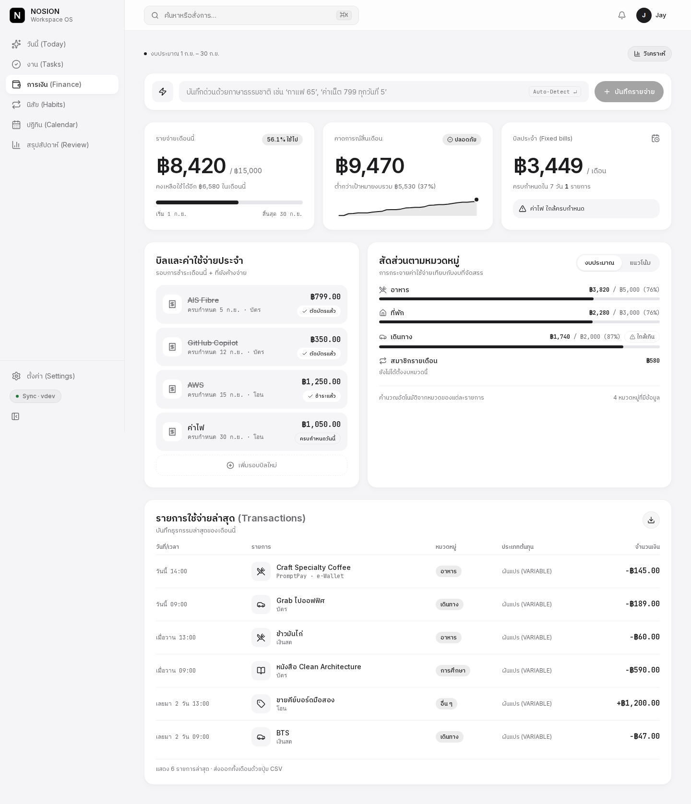
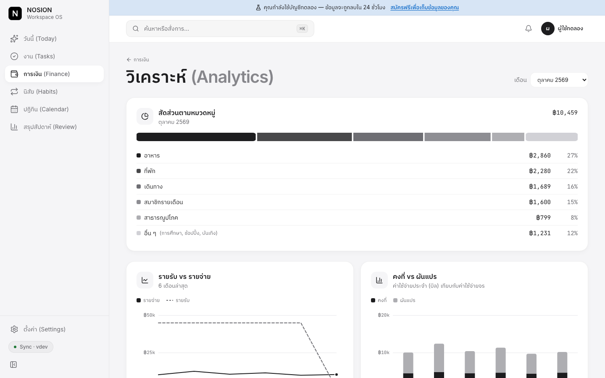
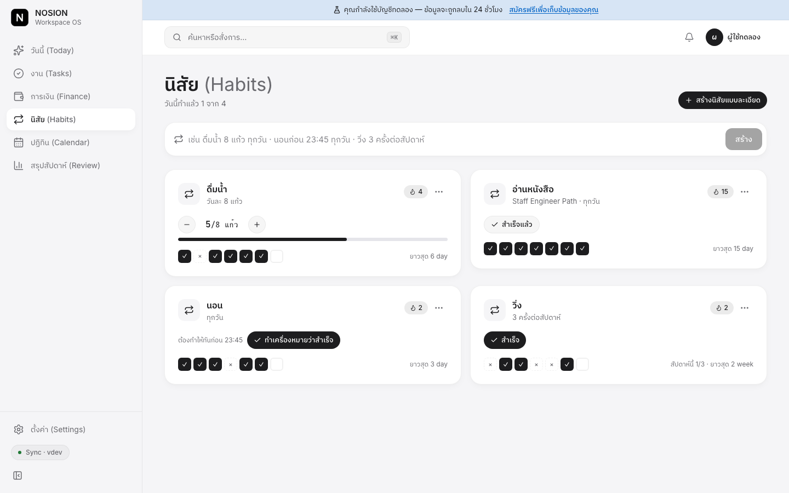
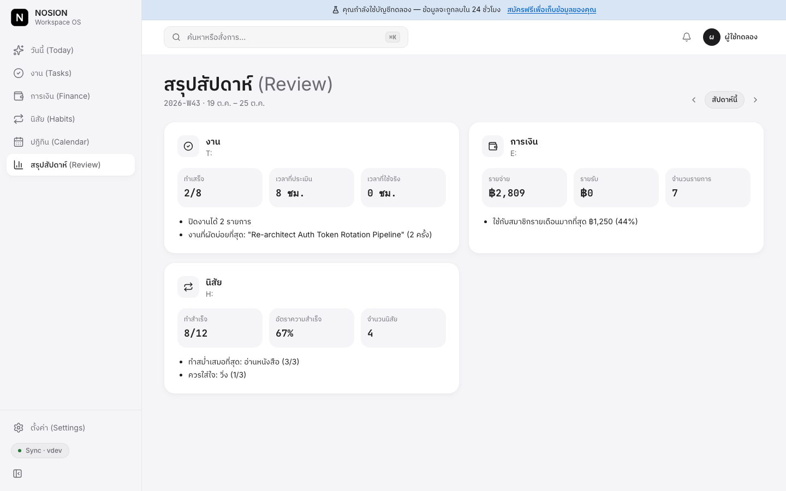
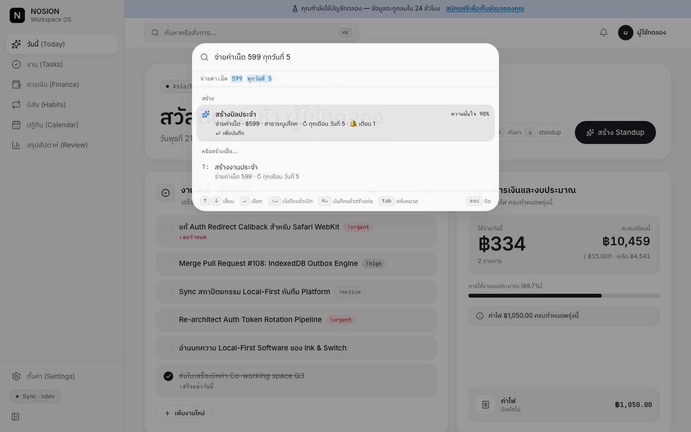
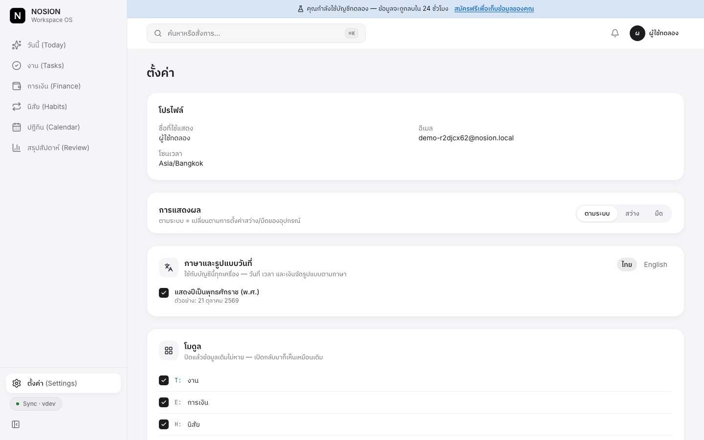
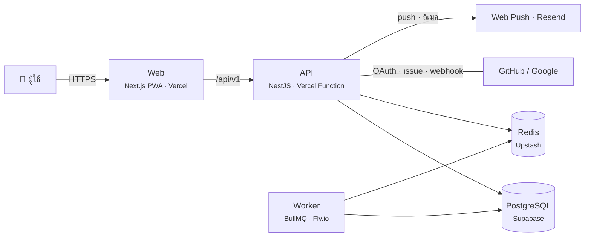

# NOSION

**[ลองใช้ demo](https://nosion-staging-web.vercel.app)** · [แผนภาพระบบ](./docs/diagrams/README.md)

แอปจัดการชีวิตประจำวันในที่เดียว: งาน การเงิน และนิสัย
คุณเปิดหน้า "วันนี้" หน้าเดียว แล้วเห็นงานที่ต้องทำ เงินที่ใช้ไป และนิสัยที่ยังไม่ได้ทำ โดยไม่ต้องสลับไปมาหลายแอป


**ลองใช้:** เปิดเว็บแล้วกด **"ลองใช้ทันที"** ระบบสร้างบัญชีทดลองพร้อมข้อมูลตัวอย่างให้ในคลิกเดียว ไม่ต้องสมัคร
ถ้าจะใช้จริง เข้าด้วยอีเมล Google หรือ GitHub ก็ได้ สลับภาษาไทย/อังกฤษได้ที่หน้าแรก

---

## วัตถุประสงค์ของโปรเจกต์

คนส่วนใหญ่จดงานในแอปหนึ่ง จดรายจ่ายในอีกแอป และติ๊กนิสัยในแอปที่สาม พอจะดูภาพรวมของวัน คุณต้องเปิดสามแอปแล้วต่อภาพเอง

NOSION รวมสามเรื่องนี้ไว้ในแอปเดียว:

- **เห็นภาพรวมของวันในหน้าเดียว:** งานที่ต้องทำ เงินที่ใช้ไปเทียบกับงบ และนิสัยที่ยังไม่ได้ทำ
- **จดได้เร็ว:** พิมพ์เป็นประโยคธรรมดา แอปแยกให้เองว่าเป็นงาน รายจ่าย หรือนิสัย
- **ไม่พลาดของสำคัญ:** แอปเตือนก่อนถึงกำหนดงานและวันจ่ายบิล
- **ใช้ได้ทุกที่:** เปิดบนคอมหรือมือถือ ใช้ตอนไม่มีเน็ตได้ และใช้ได้ทั้งภาษาไทยและอังกฤษ

ผมทำโปรเจกต์นี้คนเดียวเป็น portfolio ครบทั้งระบบ ตั้งแต่หน้าเว็บ API ฐานข้อมูล ระบบแจ้งเตือน การทดสอบ ไปจนถึง deploy

---

## Feature

### วันนี้ (Today)

หน้าแรกหลังเข้าสู่ระบบ รวมงานของวันนี้ ยอดใช้จ่ายเทียบงบ บิลที่ใกล้ครบกำหนด และนิสัยของวันไว้ในหน้าเดียว
บัญชีใหม่จะเห็นการ์ด "เริ่มต้นใช้งาน" ที่พาลองใช้ทีละขั้น (ภาพหน้าวันนี้อยู่ด้านบนสุดของหน้านี้)

### งาน (Tasks)

- เพิ่มงานด้วยประโยคเดียว เช่น `ส่งรายงาน พรุ่งนี้ 5 โมง !high #work`
- จัดงานด้วยโปรเจกต์ แท็ก ความสำคัญ และงานย่อย
- ดูงานแยกเป็น Inbox, วันนี้, 7 วันข้างหน้า หรือแยกตามโปรเจกต์
- เลื่อนงานไปพรุ่งนี้ได้ในคลิกเดียว ลบแล้วกู้คืนได้
- จับเวลาโฟกัสจากการ์ดงาน และดูเวลาโฟกัสรวมของวัน
- ตั้งงานซ้ำทุกวัน ทุกสัปดาห์ หรือทุกสิ้นเดือน


### การเงิน (Finance)

- พิมพ์ `กาแฟ 65` แล้วบันทึกรายจ่ายได้เลย
- ตั้งงบรายเดือนแยกตามหมวด แอปเตือนเมื่อหมวดไหนใกล้เกินงบ
- จดบิลประจำ เช่น ค่าเน็ต ค่าไฟ แล้วกดว่าจ่ายแล้ว
- ดูคาดการณ์ยอดใช้จ่ายสิ้นเดือน
- ส่งออกรายการของเดือนเป็นไฟล์ CSV



หน้าวิเคราะห์แสดงสัดส่วนตามหมวด รายรับเทียบรายจ่าย 6 เดือนล่าสุด และค่าใช้จ่ายคงที่เทียบผันแปร



### นิสัย (Habits)

- นับจำนวน เช่น ดื่มน้ำ 8 แก้ว
- ติ๊กว่าทำแล้ว เช่น อ่านหนังสือ
- ทำให้ทันก่อนเวลา เช่น นอนก่อน 23:45
- เป้าหมายรายสัปดาห์ เช่น วิ่ง 3 ครั้งต่อสัปดาห์
- นับวันที่ทำต่อเนื่อง (streak) และดูย้อนหลัง 7 วัน



### ปฏิทิน (Calendar)

- เห็นงาน บิล และนิสัยในปฏิทินเดียว สลับมุมมองเดือน สัปดาห์ หรือรายการ
- กรองตามโมดูล แล้วกดวันเพื่อดูรายละเอียด
- Subscribe ด้วย iCal เพื่อเปิดใน Google Calendar หรือ Apple Calendar


### สรุปสัปดาห์ (Weekly Review)

สรุปว่าสัปดาห์นี้ทำงานเสร็จกี่ชิ้น ใช้เงินไปกับอะไรมากที่สุด และนิสัยไหนทำสม่ำเสมอหรือควรใส่ใจ



### Command Palette (⌘K)

กด ⌘K จากหน้าไหนก็ได้ แล้วค้นหา เปิดหน้า หรือพิมพ์ประโยคเพื่อสร้างรายการ
ตัวอย่าง: พิมพ์ `จ่ายค่าเน็ต 599 ทุกวันที่ 5` แอปเสนอให้สร้างเป็นบิลประจำเดือนพร้อมการเตือน หรือสลับเป็นงานประจำก็ได้



### ใช้บนมือถือ

- ติดตั้งลงหน้าจอมือถือเป็นแอปได้ (PWA) มีธีมสว่างและธีมมืด
- ใช้ตอนไม่มีเน็ตได้ แอปเก็บสิ่งที่คุณทำไว้ในเครื่อง แล้วส่งขึ้นเซิร์ฟเวอร์เมื่อเน็ตกลับมา ถ้าแก้จากสองเครื่อง แอปรวมให้โดยไม่สร้างรายการซ้ำ
- เตือนผ่าน push notification หรืออีเมล ตั้งช่วงห้ามรบกวนได้

| การเงิน                                                                          | วันนี้ (ธีมมืด)                                                                           |
| -------------------------------------------------------------------------------- | ----------------------------------------------------------------------------------------- |
|  |  |

### ตั้งค่า

- เลือกธีม สว่าง มืด หรือตามเครื่อง
- สลับภาษาไทยหรืออังกฤษ ทั้งแอป อีเมล และการแจ้งเตือน เลือกแสดงปี พ.ศ. หรือ ค.ศ. ได้
- เปิดเฉพาะโมดูลที่ใช้ ปิดแล้วข้อมูลเดิมไม่หาย



### เชื่อมต่อภายนอก

- **เข้าสู่ระบบ:** ด้วยอีเมล, Google หรือ GitHub และผูกหลายบัญชีกับผู้ใช้คนเดียวได้
- **GitHub:** issue และ PR ที่มอบหมายให้คุณกลายเป็นงาน วันของ milestone ขึ้นในปฏิทิน และงานปิดให้เองเมื่อ PR merge
- **Public API:** สร้าง API key แบบอ่านอย่างเดียวหรืออ่าน-เขียน และเพิกถอนได้ เอกสาร Swagger อยู่ที่ `/api/v1/docs`

---

## Tech Stack

| ส่วน               | ใช้อะไร                                |
| ------------------ | -------------------------------------- |
| หน้าเว็บ           | Next.js 15, React 19                   |
| หน้าตา             | Tailwind CSS 4                         |
| ข้อมูลฝั่งหน้าเว็บ | TanStack Query, Zustand                |
| เซิร์ฟเวอร์        | NestJS 11, Node 22                     |
| ฐานข้อมูล          | PostgreSQL 17, Prisma 6                |
| คิวและแคช          | Redis 7, BullMQ                        |
| ตรวจข้อมูล         | Zod                                    |
| ล็อกอิน            | JWT, Argon2id, OAuth (Google, GitHub)  |
| ภาษา               | next-intl                              |
| อีเมล              | React Email, Resend                    |
| แจ้งเตือน          | Web Push                               |
| ทดสอบ              | Vitest, Playwright, axe, Lighthouse    |
| Deploy             | Vercel, Supabase, Upstash, Fly.io      |
| Monorepo           | pnpm workspaces, Turborepo, TypeScript |

---

## ภาพรวมระบบ



โค้ดแบ่งเป็นสามแอปกับแพ็กเกจที่ใช้ร่วมกัน:

```
apps/
  web/      หน้าเว็บ (Next.js)
  api/      REST API (NestJS)
  worker/   งานเบื้องหลัง เช่น ส่งการเตือน (BullMQ)
packages/
  contracts/      Zod schema และ type ที่หน้าเว็บกับ API ใช้ร่วมกัน
  core/           interface ของโมดูล ฟังก์ชันเวลา ตัวแปลงประโยคเป็นงาน
  emails/         template อีเมล
  notifications/  ตัวส่ง push และอีเมล
  ui/             design token
```

แผนภาพละเอียดขึ้น (C4) อยู่ที่ [docs/diagrams](./docs/diagrams/README.md)

---

## รันบนเครื่อง

ต้องมี **Node 22+**, **pnpm 10+** และ **Docker**

```bash
pnpm install
pnpm setup:dev     # สร้าง .env, เปิด postgres/redis/mailpit, สร้างตาราง และใส่ข้อมูลตัวอย่าง
pnpm dev           # web :3000 · api :3001 · worker
```

เปิด http://localhost:3000 แล้วกด "ลองใช้ทันที" หรือเข้าด้วยบัญชีตัวอย่าง:

```
demo@nosion.dev / nosion-demo-2026
```

ระหว่างพัฒนา: ดูอีเมลที่ระบบส่งได้ที่ Mailpit http://localhost:8025 และเอกสาร API ที่ http://localhost:3001/api/v1/docs

ล็อกอินด้วย Google/GitHub บนเครื่อง: ใส่ `GOOGLE_*` / `GITHUB_*` ใน `.env` (ถ้าไม่ใส่ ปุ่มจะซ่อน) วิธีสร้าง OAuth app อยู่ใน [คู่มือ staging](./docs/deploy/staging-vercel-supabase.md) หัวข้อ 7

### คำสั่งที่ใช้บ่อย

```bash
pnpm dev            # รันทั้งสามแอป
pnpm verify         # lint + format + typecheck + unit test + build (รันก่อน push)
pnpm test:unit      # unit test
pnpm test:int:local # integration test บนฐาน nosion_test แยก ข้อมูล dev ไม่หาย
pnpm test:e2e       # Playwright
pnpm db:studio      # เปิด Prisma Studio ดูข้อมูล
pnpm db:reset       # ล้างฐานข้อมูลแล้วสร้างใหม่พร้อมข้อมูลตัวอย่าง
```

> `pnpm test:int` ใช้ `DATABASE_URL` ปัจจุบันและล้างทุกตาราง ใช้ใน CI เท่านั้น

### Deploy

| ที่ไหน     | ขึ้นเมื่อไร                                                                 | คู่มือ                                                                 |
| ---------- | --------------------------------------------------------------------------- | ---------------------------------------------------------------------- |
| staging    | merge เข้า `main` แล้ว CI ผ่าน                                              | [staging-vercel-supabase.md](./docs/deploy/staging-vercel-supabase.md) |
| production | push tag `v*.*.*` แล้วกดอนุมัติ ถ้า smoke test ไม่ผ่าน ระบบ rollback ให้เอง | [production.md](./docs/deploy/production.md)                           |

---

## การทดสอบ

| ระดับ       | เครื่องมือ             | ตรวจอะไร                                                            |
| ----------- | ---------------------- | ------------------------------------------------------------------- |
| Unit        | Vitest                 | การคำนวณเวลา เขตเวลา งานซ้ำ ตัวแปลงประโยค                           |
| Integration | Vitest + Postgres จริง | ล็อกอินทั้งวงจร, ผู้ใช้คนหนึ่งเปิดข้อมูลของอีกคนไม่ได้, การแก้ชนกัน |
| E2E         | Playwright + API จริง  | ลองใช้ทันทีแล้วสร้างงาน, ใช้ตอนออฟไลน์แล้ว sync ไม่ซ้ำ              |
| UI          | Playwright + axe       | การเข้าถึง (a11y) ทุกหน้า สองธีม สองภาษา และเทียบภาพหน้าจอ          |
| Performance | Lighthouse             | หน้าหลักบนมือถือและเดสก์ท็อป (กดรันเองได้)                          |

integration test ใช้ฐานข้อมูลจริงแทน mock เพราะ mock จับบั๊กเรื่อง constraint และ transaction ไม่ได้
