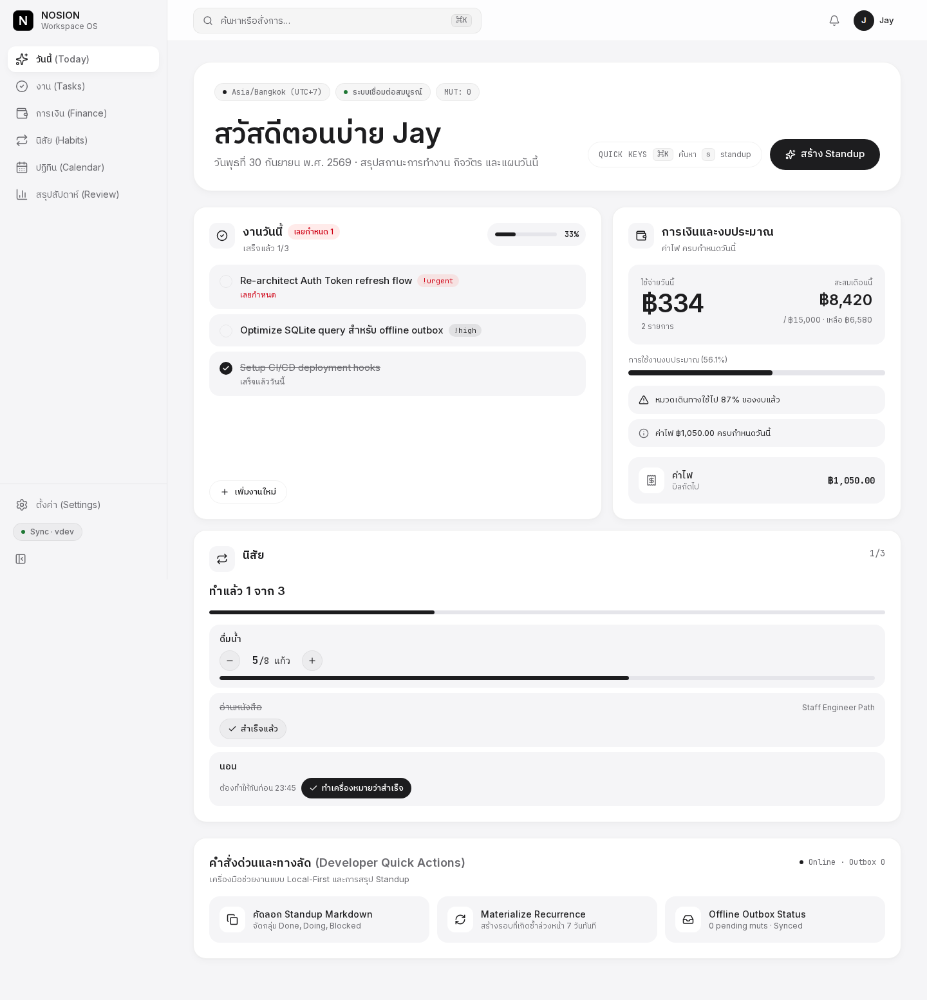
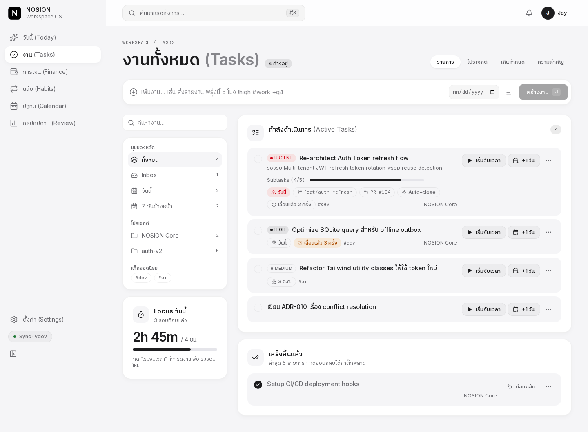
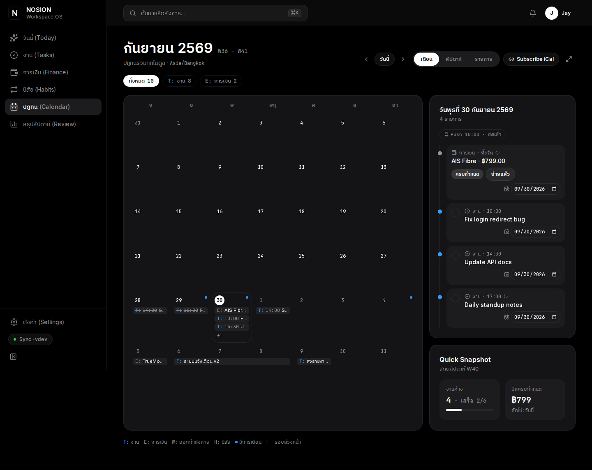
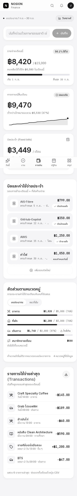
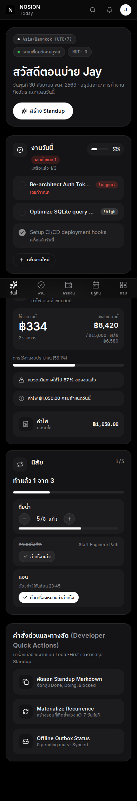
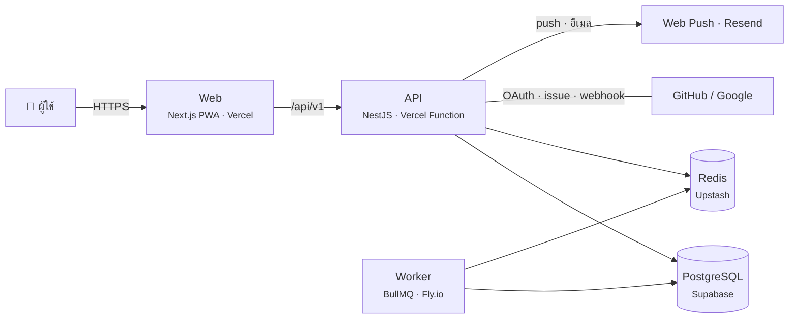

# NOSION

**[ลองใช้ demo](https://nosion-staging-web.vercel.app)** · [เอกสารการตัดสินใจ (ADR)](./docs/adr) · [แผนภาพระบบ](./docs/diagrams/README.md)

แอปจัดการชีวิตประจำวันในที่เดียว: งาน การเงิน และนิสัย
คุณเปิดหน้า "วันนี้" หน้าเดียว แล้วเห็นงานที่ต้องทำ เงินที่ใช้ไป และนิสัยที่ยังไม่ได้ทำ โดยไม่ต้องสลับไปมาหลายแอป



**ลองใช้:** เปิดเว็บแล้วกด **"ลองใช้ทันที"** ระบบสร้างบัญชีทดลองพร้อมข้อมูลตัวอย่างให้ในคลิกเดียว ไม่ต้องสมัคร
ถ้าจะใช้จริง เข้าด้วยอีเมล Google หรือ GitHub ก็ได้ สลับภาษาไทย/อังกฤษได้ที่หน้าแรก

---

## วัตถุประสงค์ของโปรเจกต์

ผมสร้าง NOSION เป็น portfolio project เพื่อฝึกและแสดงงานระดับ production ครบทั้งระบบ ตั้งแต่ออกแบบสถาปัตยกรรม เขียน API และหน้าเว็บ ไปจนถึงทดสอบและ deploy

แอปจดงานมีให้เห็นใน GitHub เป็นพันโปรเจกต์ ผมจึงตั้งโจทย์ 5 ข้อที่ tutorial ส่วนใหญ่ข้ามไป แล้วทำแต่ละข้อให้ถูกจริง:

| #   | โจทย์                           | ยากตรงไหน                                                               | ผลที่ได้                                                                                                       |
| --- | ------------------------------- | ----------------------------------------------------------------------- | -------------------------------------------------------------------------------------------------------------- |
| 1   | **เพิ่มโมดูลได้โดยไม่แก้ core** | หน้าวันนี้ ปฏิทิน และ ⌘K ต้องรู้จักโมดูลใหม่เองโดยไม่มี `if` แยกตามชนิด | เพิ่มโมดูลนิสัยโดยแก้ `core/` 0 บรรทัด                                                                         |
| 2   | **งานซ้ำ**                      | เขตเวลา, เวลาฤดูร้อน (DST), วันที่ 31 ในเดือนที่มี 30 วัน               | ฟังก์ชันคำนวณที่ทดสอบได้โดยไม่ต้องมีฐานข้อมูล ([ADR-010](./docs/adr/010-floating-time-and-month-end-clamp.md)) |
| 3   | **การเตือน**                    | ต้องส่งตรงเวลา ไม่ซ้ำ ไม่หาย แม้เซิร์ฟเวอร์รีสตาร์ต                     | outbox + retry + quiet hours ([ADR-011](./docs/adr/011-reminders-outbox-polling.md))                           |
| 4   | **ใช้ตอนออฟไลน์**               | ส่งซ้ำต้องไม่สร้างรายการซ้ำ สองเครื่องแก้พร้อมกันต้องไม่ทับกันเงียบ ๆ   | E2E ตัดเน็ต สร้าง 3 งาน ต่อเน็ต เซิร์ฟเวอร์ได้ครบ 3 ไม่ซ้ำ                                                     |
| 5   | **CI/CD ครบวงจร**               | test, build, migrate, deploy, smoke test และ rollback ต้องรันเองทั้งหมด | production deploy จาก tag พร้อม backup และ rollback อัตโนมัติ                                                  |

ทุกการตัดสินใจหลักมีบันทึกเหตุผลและข้อเสียที่ยอมรับไว้ใน [docs/adr](./docs/adr) (17 ฉบับ)

---

## ใช้ทำอะไรได้บ้าง

| โมดูล           | ทำอะไรได้                                                                                           |
| --------------- | --------------------------------------------------------------------------------------------------- |
| **งาน**         | สร้าง ค้นหา กรอง เลื่อนวัน แยกโปรเจกต์และแท็ก จับเวลาโฟกัส ตั้งงานซ้ำทุกวัน/ทุกสัปดาห์/ทุกสิ้นเดือน |
| **การเงิน**     | พิมพ์ "กาแฟ 65" แล้วบันทึกเลย ตั้งงบรายหมวด จดบิลประจำ ดูคาดการณ์ยอดสิ้นเดือน                       |
| **นิสัย**       | นับจำนวน ("ดื่มน้ำ 8 แก้ว") ติ๊กว่าทำแล้ว หรือกำหนดให้ทำก่อนเวลา พร้อมนับวันต่อเนื่อง (streak)      |
| **ปฏิทิน**      | รวมทุกโมดูลในปฏิทินเดียว ส่งออกเป็น iCal ไปเปิดใน Google Calendar หรือ Apple Calendar               |
| **สรุปสัปดาห์** | ดูว่าสัปดาห์นี้ทำงานเสร็จกี่ชิ้น ใช้เงินไปเท่าไร ทำนิสัยครบกี่วัน                                   |

ความสามารถอื่น:

- กด **⌘K** แล้วพิมพ์เป็นประโยค เช่น "ส่งรายงาน พรุ่งนี้ 5 โมง" แอปแปลงเป็นงานพร้อมวันเวลาให้ (อ่านได้ทั้งไทยและอังกฤษ)
- เตือนผ่าน push notification หรืออีเมล และตั้งช่วงห้ามรบกวนได้
- ใช้ตอนไม่มีเน็ตได้ แอปเก็บสิ่งที่คุณทำไว้ในเครื่อง แล้วส่งขึ้นเซิร์ฟเวอร์เมื่อเน็ตกลับมา
- ติดตั้งลงมือถือเป็นแอปได้ (PWA) มีธีมสว่างและธีมมืด
- ดึง issue และ PR บน GitHub ที่มอบหมายให้คุณมาเป็นงาน และปิดงานให้เองเมื่อ PR merge
- มี Public API พร้อม API key สำหรับเขียนสคริปต์ของคุณเอง (เอกสาร Swagger อยู่ที่ `/api/v1/docs`)

### ภาพหน้าจอ

| งาน                                     | ปฏิทิน (ธีมมืด)                                     |
| --------------------------------------- | --------------------------------------------------- |
|  |  |

| การเงินบนมือถือ                                                                  | วันนี้บนมือถือ (ธีมมืด)                                                                   |
| -------------------------------------------------------------------------------- | ----------------------------------------------------------------------------------------- |
|  |  |

---

## Tech Stack

| ส่วน               | ใช้อะไร                               | ทำไม                                                                |
| ------------------ | ------------------------------------- | ------------------------------------------------------------------- |
| หน้าเว็บ           | Next.js 15, React 19                  | ทำหน้าเว็บที่โหลดเร็วและติดตั้งเป็นแอปได้                           |
| หน้าตา             | Tailwind CSS 4 + design token         | คุมสี ระยะ และสองธีมจากที่เดียว                                     |
| ข้อมูลฝั่งหน้าเว็บ | TanStack Query, Zustand               | แยกข้อมูลจากเซิร์ฟเวอร์ออกจากสถานะของหน้าจอ                         |
| เซิร์ฟเวอร์        | NestJS 11 บน Node 22                  | ระบบ dependency injection ช่วยให้เพิ่มโมดูลใหม่ได้โดยไม่แก้โค้ดกลาง |
| ฐานข้อมูล          | PostgreSQL 17 + Prisma 6              | เก็บข้อมูลต่างชนิดในตารางเดียวด้วย JSONB และเขียน query แบบมี type  |
| คิวและแคช          | Redis 7 + BullMQ                      | ตั้งเวลาส่งการเตือน และจำกัดจำนวนคำขอ                               |
| ตรวจข้อมูล         | Zod                                   | ใช้ schema ชุดเดียวกันตรวจทั้งฟอร์มหน้าเว็บและ API                  |
| ล็อกอิน            | JWT, Argon2id, OAuth (Google, GitHub) | เขียนเองทั้งหมด เพื่อคุมความปลอดภัยทุกขั้น                          |
| ภาษา               | next-intl                             | แปลไทย/อังกฤษทั้งแอป อีเมล และการแจ้งเตือน                          |
| อีเมล              | React Email + Resend                  | เขียน template อีเมลด้วย React                                      |
| ทดสอบ              | Vitest, Playwright, axe, Lighthouse   | ทดสอบตั้งแต่ฟังก์ชันเล็ก ๆ ไปจนถึงการใช้งานจริงบนเบราว์เซอร์        |
| Deploy             | Vercel, Supabase, Upstash, Fly.io     | ทั้งชุดใช้แพ็กเกจฟรีได้สำหรับ staging                               |
| Monorepo           | pnpm workspaces, Turborepo            | แชร์ type ระหว่างหน้าเว็บกับเซิร์ฟเวอร์ และ cache การ build         |

เหตุผลของการตัดสินใจหลักแต่ละข้ออยู่ใน [docs/adr](./docs/adr)

---

## ภาพรวมระบบ



โค้ดแบ่งเป็นสามแอปกับแพ็กเกจที่ใช้ร่วมกัน:

```
apps/
  web/      หน้าเว็บ (Next.js)
  api/      REST API (NestJS)
  worker/   งานเบื้องหลัง เช่น ส่งการเตือน (BullMQ)
packages/
  contracts/      Zod schema และ type ที่หน้าเว็บกับ API ใช้ร่วมกัน
  core/           interface ของโมดูล ฟังก์ชันเวลา ตัวแปลงประโยคเป็นงาน
  emails/         template อีเมล
  notifications/  ตัวส่ง push และอีเมล
  ui/             design token
```

แผนภาพละเอียดขึ้น (C4) อยู่ที่ [docs/diagrams](./docs/diagrams/README.md)

---

## จุดที่น่าสนใจทางเทคนิค

**เพิ่มโมดูลใหม่โดยไม่แก้โค้ดกลาง.** ทุกโมดูลใช้ interface เดียวกัน (`TrackableModule`) และลงทะเบียนตัวเองตอนแอปเริ่มทำงาน
ตอนเพิ่มโมดูลนิสัย เราแก้ `AppModule` 2 บรรทัด และแก้โค้ดใน `core/` 0 บรรทัด
หน้าวันนี้ ปฏิทิน iCal สรุปสัปดาห์ และ ⌘K รองรับนิสัยทันที ([รายละเอียด](docs/phases/phase-6-habit.md))

**กฎสถาปัตยกรรมเป็น lint rule.** ถ้ามีคน import ข้ามโมดูล หรือให้ controller เรียกฐานข้อมูลตรง ๆ CI จะไม่ผ่าน ([ADR-006](./docs/adr/006-architecture-boundaries-as-lint.md))

**ล็อกอินที่ทนการขโมย token.** refresh token เปลี่ยนใบใหม่ทุกครั้งที่ใช้ ถ้าใบเก่าถูกนำมาใช้ซ้ำ ระบบยกเลิก token ทั้งชุดแล้วส่งอีเมลแจ้งคุณ ([ADR-005](./docs/adr/005-refresh-token-rotation.md))

**สองเครื่องแก้พร้อมกันไม่ทับกัน.** แก้คนละช่อง ระบบรวมให้เอง แก้ช่องเดียวกัน ค่าบนเซิร์ฟเวอร์ชนะ แล้วแอปแสดงให้คุณเห็นว่าค่าไหนถูกแทนที่ ส่งซ้ำตอนเน็ตกระตุกก็ไม่เกิดรายการซ้ำ ([ADR-014](./docs/adr/014-offline-outbox-and-field-merge.md))

**เวลาและเขตเวลา.** บิล "ทุกวันที่ 31" ไม่หายไปในเดือนที่มี 30 วัน ระบบย้ายไปวันสุดท้ายของเดือนนั้นแทน และงาน "ทุกวัน 9 โมงเช้า" ยังขึ้น 9 โมงเช้าตรงทั้งก่อนและหลังเปลี่ยนเวลาฤดูร้อน (DST) ([ADR-010](./docs/adr/010-floating-time-and-month-end-clamp.md))

---

## รันบนเครื่อง

ต้องมี **Node 22+**, **pnpm 10+** และ **Docker**

```bash
pnpm install
pnpm setup:dev     # สร้าง .env, เปิด postgres/redis/mailpit, สร้างตาราง และใส่ข้อมูลตัวอย่าง
pnpm dev           # web :3000 · api :3001 · worker
```

เปิด http://localhost:3000 แล้วกด "ลองใช้ทันที" หรือเข้าด้วยบัญชีตัวอย่าง:

```
demo@nosion.dev / nosion-demo-2026
```

ระหว่างพัฒนา: ดูอีเมลที่ระบบส่งได้ที่ Mailpit http://localhost:8025 และเอกสาร API ที่ http://localhost:3001/api/v1/docs

ล็อกอินด้วย Google/GitHub บนเครื่อง: ใส่ `GOOGLE_*` / `GITHUB_*` ใน `.env` (ถ้าไม่ใส่ ปุ่มจะซ่อน) วิธีสร้าง OAuth app อยู่ใน [คู่มือ staging](./docs/deploy/staging-vercel-supabase.md) หัวข้อ 7

### คำสั่งที่ใช้บ่อย

```bash
pnpm dev            # รันทั้งสามแอป
pnpm verify         # lint + format + typecheck + unit test + build (รันก่อน push)
pnpm test:unit      # unit test
pnpm test:int:local # integration test บนฐาน nosion_test แยก ข้อมูล dev ไม่หาย
pnpm test:e2e       # Playwright
pnpm db:studio      # เปิด Prisma Studio ดูข้อมูล
pnpm db:reset       # ล้างฐานข้อมูลแล้วสร้างใหม่พร้อมข้อมูลตัวอย่าง
```

> `pnpm test:int` ใช้ `DATABASE_URL` ปัจจุบันและล้างทุกตาราง ใช้ใน CI เท่านั้น

### Deploy

| ที่ไหน     | ขึ้นเมื่อไร                                                                 | คู่มือ                                                                 |
| ---------- | --------------------------------------------------------------------------- | ---------------------------------------------------------------------- |
| staging    | merge เข้า `main` แล้ว CI ผ่าน                                              | [staging-vercel-supabase.md](./docs/deploy/staging-vercel-supabase.md) |
| production | push tag `v*.*.*` แล้วกดอนุมัติ ถ้า smoke test ไม่ผ่าน ระบบ rollback ให้เอง | [production.md](./docs/deploy/production.md)                           |

---

## การทดสอบ

| ระดับ       | เครื่องมือ             | ตรวจอะไร                                                            |
| ----------- | ---------------------- | ------------------------------------------------------------------- |
| Unit        | Vitest                 | การคำนวณเวลา เขตเวลา งานซ้ำ ตัวแปลงประโยค                           |
| Integration | Vitest + Postgres จริง | ล็อกอินทั้งวงจร, ผู้ใช้คนหนึ่งเปิดข้อมูลของอีกคนไม่ได้, การแก้ชนกัน |
| E2E         | Playwright + API จริง  | ลองใช้ทันทีแล้วสร้างงาน, ใช้ตอนออฟไลน์แล้ว sync ไม่ซ้ำ              |
| UI          | Playwright + axe       | การเข้าถึง (a11y) ทุกหน้า สองธีม สองภาษา และเทียบภาพหน้าจอ          |
| Performance | Lighthouse             | หน้าหลักบนมือถือและเดสก์ท็อป (กดรันเองได้)                          |

integration test ใช้ฐานข้อมูลจริงแทน mock เพราะ mock จับบั๊กเรื่อง constraint และ transaction ไม่ได้

---

## สิ่งที่เรียนรู้

- **DI container มีไว้เพื่อสิ่งที่ทำมือได้ยาก.** NestJS ค้นหาโมดูลที่ลงทะเบียนไว้ให้เองตอนเริ่มแอป ถ้าผมเลือก framework ที่ไม่มี DI ผมต้อง import ทุกโมดูลเข้าทะเบียนเอง และเป้าหมาย "แก้ core 0 บรรทัด" ก็จบตั้งแต่วันแรก
- **กฎที่ไม่มีเครื่องมือบังคับ ผมเองก็ละเมิด.** ตอนเขียนทะเบียนโมดูล ผมเกือบ import `@nestjs/core` เข้า domain logic ด้วยความเคยมือ lint rule จับได้ก่อน commit
- **`import type` ทำให้ DI พังตอนรัน.** กฎ lint ที่ดีในโปรเจกต์ทั่วไปทำให้ NestJS หา dependency ไม่เจอ ทั้งที่ compile ผ่าน ผมปิดกฎนี้เฉพาะฝั่ง API และจดเหตุผลไว้ในไฟล์ config
- **เขตเวลาต้องคิดตั้งแต่ออกแบบ schema.** ผมเก็บเวลาเป็น UTC ทั้งหมดแล้วแปลงที่ชั้น application จึงทดสอบเคส DST ด้วยฟังก์ชันล้วน ๆ ได้ ไม่ต้องเปิดฐานข้อมูล

---

## อ่านต่อ

- [docs/learn](./docs/learn): บทเรียน 21 ตอน อธิบายเทคโนโลยีทุกตัวในโปรเจกต์ตั้งแต่พื้นฐาน เปิด [index.html](./docs/learn/index.html) เพื่อดูสารบัญ
- [docs/adr](./docs/adr): บันทึกการตัดสินใจทางสถาปัตยกรรม
- [docs/phases](./docs/phases/README.md): บันทึกการทำงานทีละ Phase (Phase 0–8 เสร็จแล้ว)

งานที่ยังค้าง: วิดีโอสาธิต 2 นาที, เปิด production จริง (workflow พร้อมแล้ว), ทดสอบ push บนมือถือจริง
