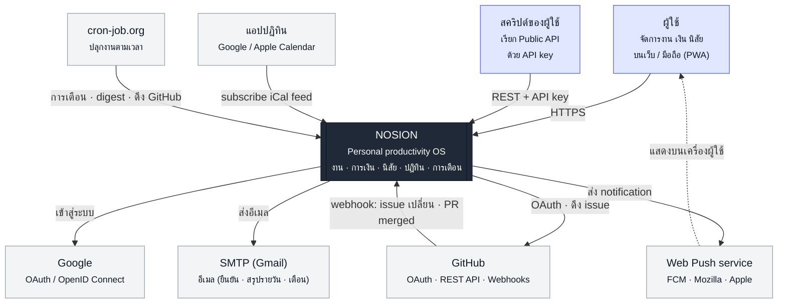
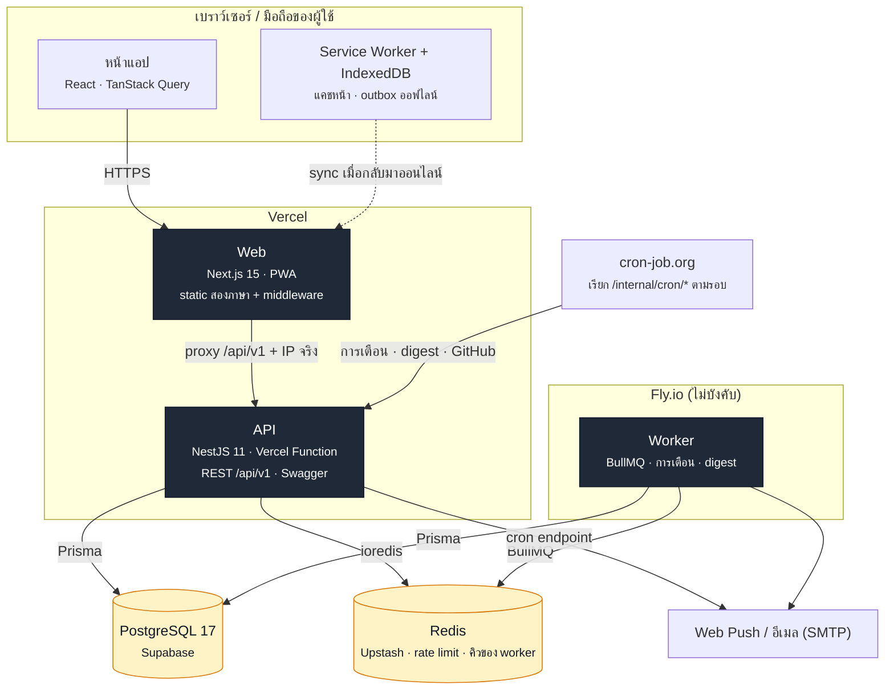

# แผนภาพสถาปัตยกรรม (C4)

> แบบ [C4 model](https://c4model.com) สองระดับแรก — **Context** (ระบบกับโลกภายนอก) และ **Container** (สิ่งที่ deploy แยกกัน)
> เขียนเป็น Mermaid ใน Markdown → GitHub วาดให้เอง แก้พร้อมโค้ดใน PR เดียวกันได้ (รูปภาพ export แยกจะล้าสมัยเงียบ ๆ)

## ระดับ 1 · System Context

ใครใช้ NOSION และ NOSION คุยกับระบบภายนอกอะไรบ้าง



## ระดับ 2 · Container

ภายใน NOSION มีอะไรที่ deploy แยกกัน และคุยกันอย่างไร (staging/production ใช้โครงเดียวกัน)



### เส้นทางที่ควรรู้

| เส้นทาง                        | ทำไมเป็นแบบนี้                                                                                               | อ่านต่อ                                       |
| ------------------------------ | ------------------------------------------------------------------------------------------------------------ | --------------------------------------------- |
| เว็บ proxy `/api/v1/*` ไป API  | refresh cookie (`SameSite=Strict`) เป็น first-party · ไม่ต้องเปิด CORS ข้ามโดเมน · แนบ IP จริงให้ rate limit | `apps/web/src/middleware.ts` · Phase 8 ขั้น 2 |
| ภาษา = คุกกี้ → rewrite ภายใน  | URL ไม่มี `/en` แต่ทุกหน้ายัง static ทั้งสองภาษา                                                             | Phase 8 ขั้น 6                                |
| การเตือนทำได้สองทาง            | Vercel ไม่มี process ค้าง → cron-job.org เรียก endpoint ของ API · ย้ายไป worker เมื่อมี Fly                  | ADR-011 · `docs/deploy/`                      |
| ออฟไลน์ = outbox ในเบราว์เซอร์ | สร้าง/แก้ตอนไม่มีเน็ต ส่งซ้ำได้โดยไม่ซ้ำ (`opId`) แก้ชนระดับ field                                           | ADR-014                                       |
| GitHub → งาน                   | ดึงด้วย OAuth token (เข้ารหัส AES-256-GCM) + webhook ตรวจ HMAC จาก body ดิบ                                  | Phase 8 ขั้น 5                                |

## ระดับ 3 · Component (ภายใน API)

ระดับนี้อยู่ในโค้ดแล้ว — กฎขอบเขตถูกบังคับด้วย lint (ADR-006):

```
apps/api/src/
  core/         registry · parser            ← ห้ามรู้จัก modules/
  modules/      task · expense · habit       ← ห้าม import ข้ามกัน · ลงทะเบียนด้วย @RegisterModule()
  entries/      CRUD กลาง · Today · Review   ← วนลูปบน registry ไม่มี if (module === …)
  auth/         session · OAuth · API key
  integrations/ GitHub
  infra/        Prisma · Redis · mail · crypto
```
